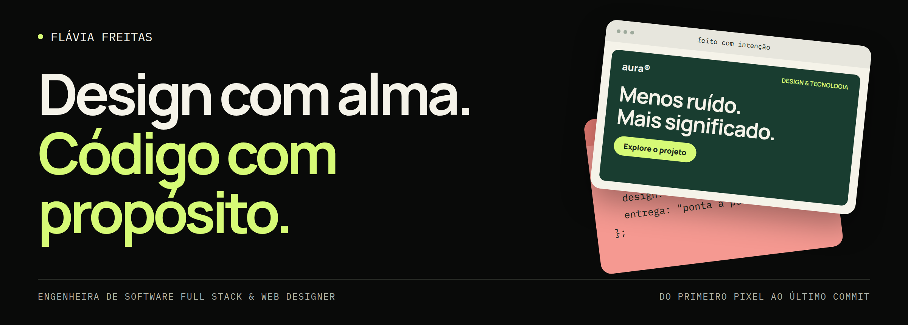

Sou a **Flávia**, engenheira de software full stack e web designer. Desenho interfaces no Figma e escrevo o código que dá vida a elas. Gosto de cuidar dos dois lados de um site — de quem navega pelo celular e de quem abre o painel para publicar algo novo.

### Na minha bancada

| Área | Ferramentas |
| :--- | :--- |
| Design de interfaces | Figma |
| Front-end | Vue.js · Nuxt · TypeScript · JavaScript · HTML · SCSS |
| Back-end e conteúdo | PHP · Node.js · WordPress · Sanity |

[Explore meus projetos ↗](https://github.com/flaviafreitas?tab=repositories)　·　[LinkedIn ↗](https://www.linkedin.com/in/fl%C3%A1via-freitas/)　·　[Me escreva ↗](mailto:flaviarobertasf@gmail.com)
